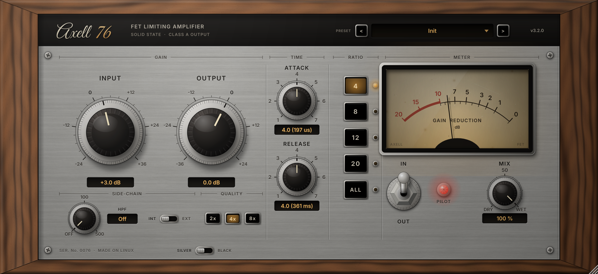
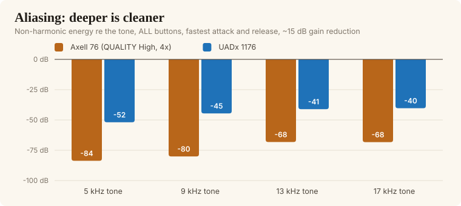
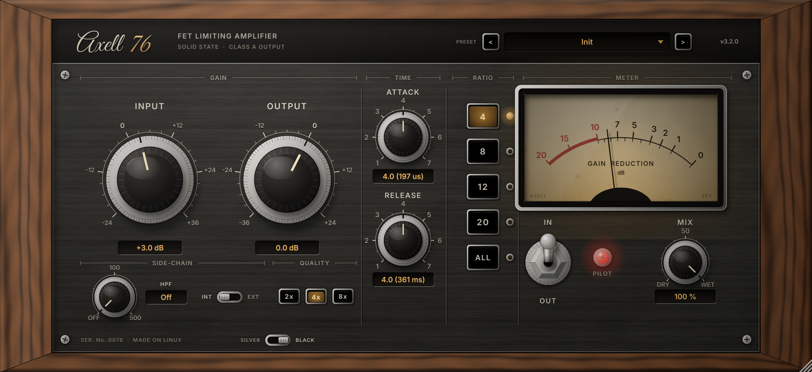
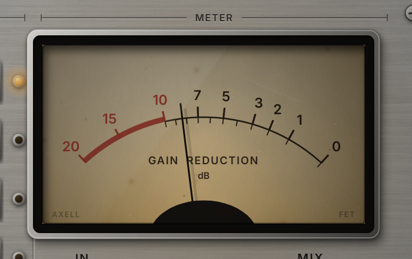
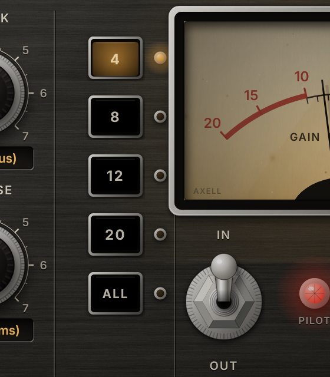
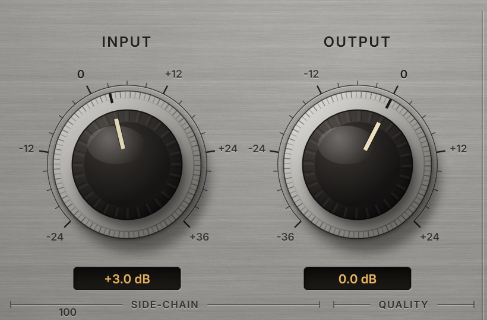
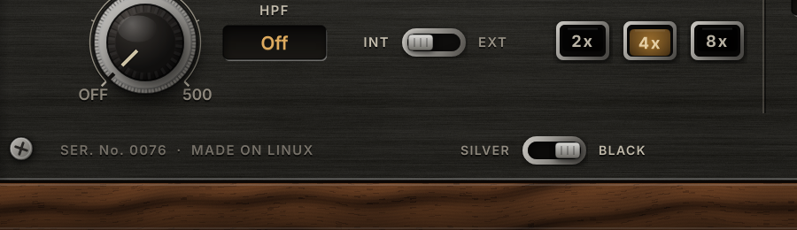
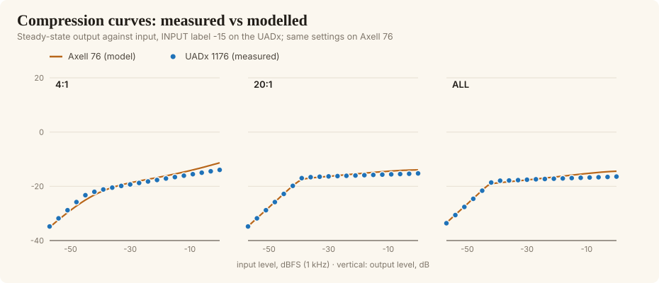
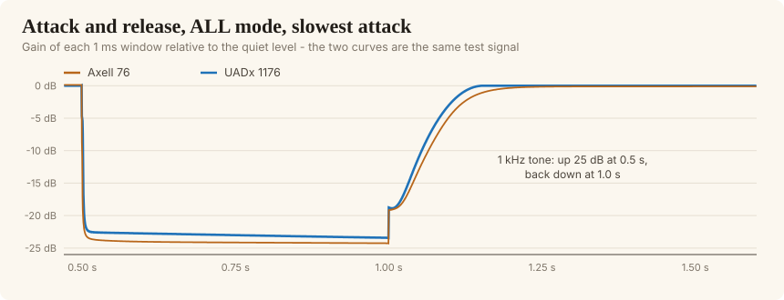
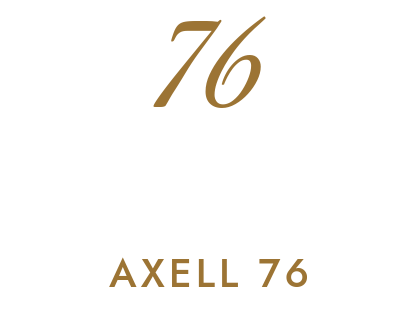

<p align="center">
  <picture>
    <source media="(prefers-color-scheme: dark)" srcset="docs/img/type/hero-dark.png">
    
  </picture>
</p>

<p align="center">
  <a href="https://github.com/zmardanian/axell-76/releases/latest"></a>
  <a href="https://github.com/zmardanian/axell-76/releases"></a>
  
  
  
  <a href="https://ko-fi.com/axellyobag"></a>
</p>

<p align="center">
  
</p>

<p align="center">
  <b>A 1176-style FET limiter for Linux and Windows, built from measurements of the real hardware.</b><br>
  Walnut, brushed aluminium and an amber-lit meter on the outside. Underneath, a compressor that follows a genuine<br>
  1176LN as closely as Universal Audio's own UADx 1176 - with a fraction of its aliasing.
</p>

<!-- download -->
<p align="center">
  <a href="https://github.com/zmardanian/axell-76/releases/latest"><picture>
  <source media="(prefers-color-scheme: dark)" srcset="docs/img/type/dl-windows-dark.png">
  
</picture></a>
  &nbsp;&nbsp;
  <a href="https://github.com/zmardanian/axell-76/releases/latest"><picture>
  <source media="(prefers-color-scheme: dark)" srcset="docs/img/type/dl-linux-dark.png">
  
</picture></a>
</p>

<p align="center"><sub>Free and open source (AGPL-3.0)  ·  Windows 10 / 11 and Linux  ·  any VST3 host - FL Studio, Ableton Live, Cubase, Studio One, Bitwig, REAPER</sub></p>

<p align="center"><a href="https://ko-fi.com/axellyobag"></a></p>
<!-- /download -->

<br>

<picture>
  <source media="(prefers-color-scheme: dark)" srcset="docs/img/type/h-sound-dark.png">
  
</picture>

Every claim below is a measurement, made with the same scripts, the same material and the same calibration for each
plugin.

| | **Axell 76 3.2** | UADx 1176 |
|---|:---:|:---:|
| Distance from a **real 1176LN** - notes it never trained on (mean · median · p90) | 0.44 · 0.37 · 0.80 dB | 0.44 · 0.37 · 0.79 dB with ATTACK at 4 &nbsp;·&nbsp; 0.91 · 0.88 · 1.12 dB at the panel setting |
| Waveform match with the real 1176LN (median error, lower is better) | −25.5 dB | −15.9 dB at the panel setting (not measured at ATTACK 4) |
| Aliasing on hard, fast settings (5 - 17 kHz tones, default quality) | **−68 to −90 dB** | −40 to −56 dB |
| Follows the UADx on music it never heard (100 songs, median clip) | 0.65 dB | - |
| CPU, one core, 48 kHz, 4x oversampling, always compressing | ~2 % | 2.3 % (Wine bridge) |

**Read the first row fairly.** The hardware was recorded at ALL, attack 800 µs, release 1100 ms - position 1 on both knobs. At those
positions Axell 76 is 0.44 dB from it and the UADx 0.91 dB; with its ATTACK at 4 the UADx reaches 0.44 dB as well (149 of the
held-out notes, each plugin at its best input level). Real units differ in their time constants, and since 3.2 Axell 76 has
learned from this unit - so the honest reading is a tie: both follow a real 1176LN equally closely.

**The reference.** The hardware recordings are public - Martinez Ramirez, Benetos & Reiss, *Deep Learning for
Black-Box Modeling of Audio Effects*, Appl. Sci. 10(2) 638, 2020 ([Zenodo 3562442](https://zenodo.org/records/3562442),
CC BY 4.0): a 1176LN at ALL, 800 µs, 1100 ms. Since 3.2 Axell 76 learns from half of these notes alongside the UADx
measurements; the other 593 are kept out of the fit and score every version.

**When the UADx and the hardware disagree, Axell 76 sides with the hardware.** Its harmonic character sits between
the two: the FET's odd harmonics are 75 % of the way to the UADx's, while the added distortion stays closer to the real
unit's.

<p align="center"></p>

<br>

<picture>
  <source media="(prefers-color-scheme: dark)" srcset="docs/img/type/h-presets-dark.png">
  
</picture>

Each preset is a stated intention - *more chest punch*, *a 2 dB pocket for the vocal* - found by searching the
plugin's own engine on real material, matched in loudness to bypass so an A/B compares sound rather than level, and
checked on material it was not tuned on. [What every preset measurably does &rarr;](docs/PRESETS.md)

| Group | | |
|---|:---:|---|
| **Signature** | 10 | Tuned on the artist's voice: chest punch, presence, grit and control - Main Lead, Chest Punch, Presence Forward, Grit & Bite, Boom Bap Lead, Smooth Control, Ad-lib Smash, Parallel Thickener, Radio Forward, Low-Energy Lift |
| **Vocal** | 10 | Transparent Levelling, Pop Polish, Rap Double, Backing Glue, Spoken Word, Hook Lift and the classic vocal settings |
| **Beat** | 10 | Boom Bap Glue, Knock, Lo-Fi Grit, Parallel Smack, Tame the Master, Breathing Pump, Dense Loop, Warm Saturation, Low End Steady, Ready for Vocals |
| **Pocket** | 6 | The beat steps back while you rap: from a 1 dB whisper to a 4 dB dip, phrase-smooth or word by word |
| **Drums · Bass · Mix Bus** | 15 | Room Glue, Punch Snap, Parallel NY, Break Crush, Steady Low End, Growl, Gentle Glue, Loud & Dense and the classics |

> **Pocket presets** - put Axell 76 on the beat and send the lead vocal to its side-chain input; the preset switches
> SIDE-CHAIN to EXT.

<br>

<picture>
  <source media="(prefers-color-scheme: dark)" srcset="docs/img/type/h-craft-dark.png">
  
</picture>

| | |
|---|---|
| **The 1176 workflow** | INPUT drives into a fixed threshold, OUTPUT sets the level. ATTACK and RELEASE 1 - 7 (7 fastest), with the hardware's program-dependent release. RATIO 4 · 8 · 12 · 20 · ALL - each with its own threshold and slope, and ALL's famous over-compression. |
| **FET character** | Even harmonics that grow with gain reduction, odd-harmonic bite, the grit of a fast release on bass, a delicate low thump on every clamp, the coupling low-cut, the FET's soft limit. |
| **Modern control** | MIX for parallel compression (delay-matched), latency-compensated IN / OUT, QUALITY 2x · 4x · 8x oversampling, side-chain high-pass, external side-chain input. |
| **The meter** | Gain reduction, or a classic VU of the output at +4 or +8 - click the meter to switch. |
| **The cabinet** | Four walnut boards with mitred corners and a hairline seam, brushed aluminium, an aged amber-lit VU, in **SILVER** or **BLACK**; textures render at your screen's real pixel density. |
| **Safe sessions** | Projects keep the sound they were made with: 2.0, 3.0/3.1 and 3.2 sessions each render bit-for-bit as on their own release. |
| **Robust** | Any block size, mono or stereo, 44.1 - 192 kHz; NaN- and denormal-safe; click-free automation; state round-trips exactly. |

<p align="center">
  
</p>
<p align="center">
  
  
</p>
<p align="center">
  
  
</p>

<br>

<picture>
  <source media="(prefers-color-scheme: dark)" srcset="docs/img/type/h-install-dark.png">
  
</picture>

**Windows 10 / 11 (64-bit):** install the whole Axell Signature Suite with
[`AxellSignatureSuite-…-windows-x64-setup.exe`](https://github.com/zmardanian/axell-signature-dojo/releases/latest)
(Axell 76 is one of its components), or download **`Axell76-3.2.1-windows-x64.tar.gz`** from [Releases](../../releases)
and copy the `Axell 76.vst3` folder inside it into `C:\Program Files\Common Files\VST3`. Every VST3 host loads it
(REAPER, Ableton Live, FL Studio, Cubase, Studio One, Bitwig...). The Windows build is made and tested by GitHub
Actions and renders the same as the Linux build (largest difference -138.5 dBFS); it is not code-signed yet.

**Linux:** download **`Axell76-3.2.1-linux-x86_64.tar.gz`** from [Releases](../../releases), then:

```bash
tar xzf Axell76-3.2.1-linux-x86_64.tar.gz
cd Axell76-3.2.1-linux-x86_64
./install.sh            # VST3 -> ~/.vst3, LV2 -> ~/.lv2, the standalone app into your menu - no root needed
```

Runs on **any x86_64 Linux with glibc 2.30+** - Ubuntu 20.04+, Debian 11+, Fedora, Arch, Manjaro, Mint, openSUSE,
Bazzite, SteamOS. The C++ runtime is built in; only freetype and fontconfig are needed (ALSA for the standalone).
Restart your DAW after installing so it finds the plugin.

<br>

<picture>
  <source media="(prefers-color-scheme: dark)" srcset="docs/img/type/h-method-dark.png">
  
</picture>

1. **Inspected, never copied.** The UADx 1176 was examined for structure only (a JUCE plugin, five controls); its DSP
   and licensing code were deliberately not decompiled.
2. **Measured from the outside** - more than 500 test-signal settings: every ratio's curve, attack and release at every
   knob position, release memory, harmonics, intermodulation, transients, stereo link, sample rates, aliasing.
3. **Then on music** - 379 clips at random settings, 252 to learn from and 127 held back.
4. **Modelled from the circuit** - rectifier into an RC detector, attack and release in the control-voltage domain,
   program-dependent release, the FET's range and harmonics, the coupling low-cut.
5. **Anchored to the hardware** - since 3.2 the model is fitted to the UADx and to a real 1176LN together, and every
   version is judged on hardware notes it never saw.

<p align="center"></p>
<p align="center"></p>

Scripts, measurements and fits live in the development repository; the full account, including every idea that
was tried and rejected, is in [docs/REPORT.md](docs/REPORT.md).

<br>

<picture>
  <source media="(prefers-color-scheme: dark)" srcset="docs/img/type/h-history-dark.png">
  
</picture>

| Version | |
|---|---|
| **3.2.1** | Your DAW's preset menu shows the right preset after a project is reopened (the chosen preset is saved with the project and read back without re-applying it); every control named for screen readers. Sound byte-identical to 3.2.0 (186 renders) |
| **3.2** | Fitted to a real 1176LN as well as the UADx: 0.466 &rarr; 0.435 dB from the hardware on unseen notes, waveform match 0.66 dB better, the UADx's harmonics matched more closely; one trade-off - 0.015 dB less UADx-like on music. Studio-ready README. Earlier sessions keep their sound |
| **3.1** | 52 presets (40 new, 10 tuned on the artist's voice, vocal-keyed pocket ducking), grouped menu; parameter values shown correctly in every host |
| **3.0** | FET odd harmonics toward the UADx (75 %), a delicate capped thump, the walnut cabinet, HiDPI textures |
| **2.0** | Averaging detector (static curves 1.92 &rarr; 1.01 dB), QUALITY 2x / 4x / 8x, side-chain HPF and external key, VU meter modes, 12 presets, LV2 |
| **1.2** | SILVER / BLACK finish, standalone app, portable Linux build |
| **1.1** | Fitted on real music; coupling low-cut, pre-FET distortion; the vintage panel |
| **1.0** | First model, fitted to test-signal measurements |

<br>

<picture>
  <source media="(prefers-color-scheme: dark)" srcset="docs/img/type/h-build-dark.png">
  
</picture>

JUCE 8 (fetched by CMake) and the shared Axell core beside this folder (`../axell-core`).

```bash
scripts/build.sh                                         # Release build (distrobox juce-build)
build/A76DspTests                                        # DSP suite
build/A76PluginTests_artefacts/Release/A76PluginTests    # plugin suite: presets, sessions, state
scripts/pluginval.sh                                     # pluginval strictness 10 + Steinberg's VST3 validator
scripts/build-portable.sh && scripts/make-release.sh     # the portable Linux release
```

<br>

<picture>
  <source media="(prefers-color-scheme: dark)" srcset="docs/img/type/h-credits-dark.png">
  
</picture>

**Free forever, kept alive by you.** Axell 76 costs nothing and never will - no subscriptions, no licence keys. If it has earned a place in your mixes, you can [support the Dojo on Ko-fi](https://ko-fi.com/axellyobag) - one-time or monthly, from €3.


Hardware data: Martinez Ramirez, Benetos & Reiss (2020), CC BY 4.0. Music stems: MUSDB18 (research use, not
redistributed). Framework: JUCE. Typefaces: Great Vibes, Cormorant Garamond and Jost (SIL Open Font License).

*1176, 1176LN, UADx and Universal Audio are trademarks of Universal Audio, Inc. Axell 76 is an independent work, not
affiliated with or endorsed by Universal Audio; the names describe what was measured and compared. VST is a registered trademark of Steinberg Media Technologies GmbH.*

Axell 76 is licensed under the GNU AGPLv3.

<!-- suite -->
**Part of the Axell Signature suite** - nine plugins and their home, built as one family. The [Axell Signature Dojo](https://github.com/zmardanian/axell-signature-dojo) installs and updates them all - on Windows from a single installer.

<p align="center">
<table>
<tr><td align="center"><a href="https://github.com/zmardanian/axell-penta-eq"><picture>
  <source media="(prefers-color-scheme: dark)" srcset="docs/img/suite/penta-eq-dark.png">
  
</picture></a><br><sub>analog-matched EQ</sub></td><td align="center"><a href="https://github.com/zmardanian/axell-duo-compressor"><picture>
  <source media="(prefers-color-scheme: dark)" srcset="docs/img/suite/duo-compressor-dark.png">
  
</picture></a><br><sub>FET + opto + limiter</sub></td><td align="center"><a href="https://github.com/zmardanian/axell-gate"><picture>
  <source media="(prefers-color-scheme: dark)" srcset="docs/img/suite/gate-dark.png">
  
</picture></a><br><sub>voice-aware gate</sub></td><td align="center"><a href="https://github.com/zmardanian/axell-dereverb"><picture>
  <source media="(prefers-color-scheme: dark)" srcset="docs/img/suite/dereverb-dark.png">
  
</picture></a><br><sub>small-room de-reverb</sub></td><td align="center"><a href="https://github.com/zmardanian/axell-velvet"><picture>
  <source media="(prefers-color-scheme: dark)" srcset="docs/img/suite/velvet-dark.png">
  
</picture></a><br><sub>neural de-esser + warmth</sub></td></tr>
<tr><td align="center"><a href="https://github.com/zmardanian/axell-master"><picture>
  <source media="(prefers-color-scheme: dark)" srcset="docs/img/suite/master-dark.png">
  
</picture></a><br><sub>mastering limiter</sub></td><td align="center"><a href="https://github.com/zmardanian/axell-space"><picture>
  <source media="(prefers-color-scheme: dark)" srcset="docs/img/suite/space-dark.png">
  
</picture></a><br><sub>vocal reverb + delay</sub></td><td align="center"><a href="https://github.com/zmardanian/axell-forbidden-seal"><picture>
  <source media="(prefers-color-scheme: dark)" srcset="docs/img/suite/forbidden-seal-dark.png">
  
</picture></a><br><sub>saturation</sub></td><td align="center"><a href="https://github.com/zmardanian/axell-76"><picture>
  <source media="(prefers-color-scheme: dark)" srcset="docs/img/suite/76-dark.png">
  
</picture></a><br><sub>1176 FET compressor</sub></td><td align="center"><a href="https://github.com/zmardanian/axell-signature-dojo"><picture>
  <source media="(prefers-color-scheme: dark)" srcset="docs/img/suite/signature-dojo-dark.png">
  
</picture></a><br><sub>the suite's home</sub></td></tr>
</table>
</p>
<!-- /suite -->

